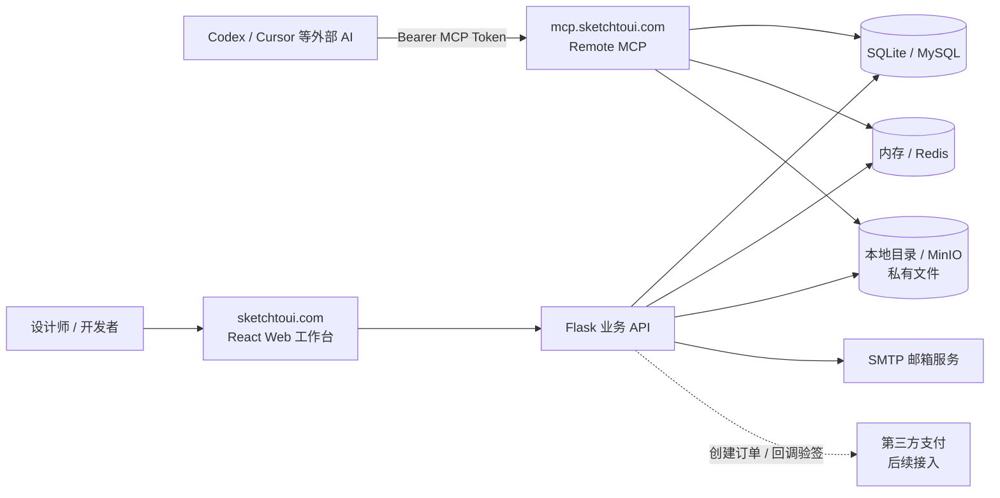
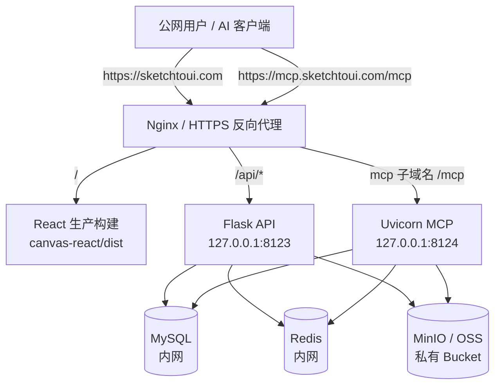
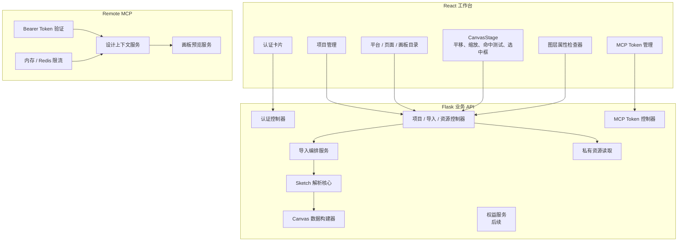
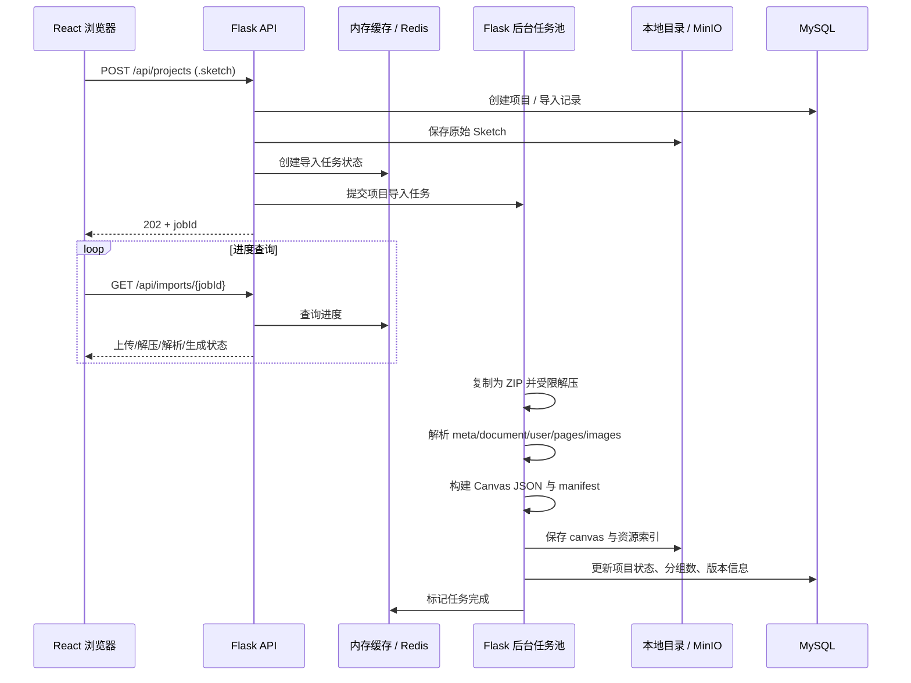
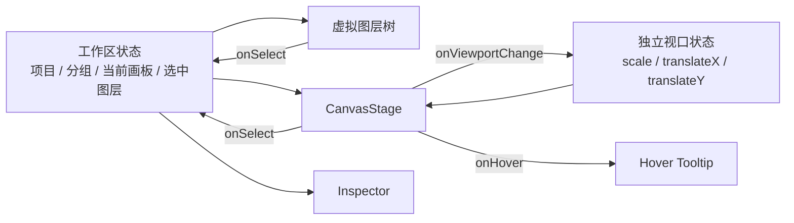
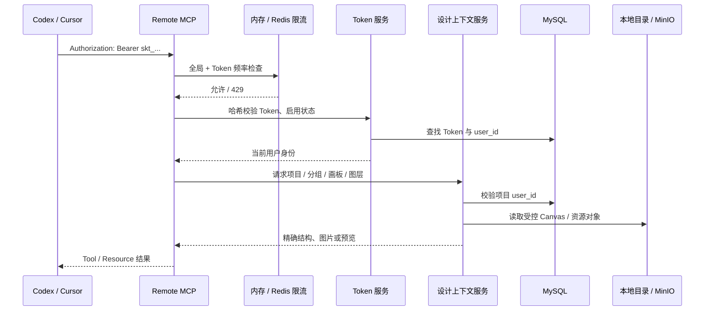
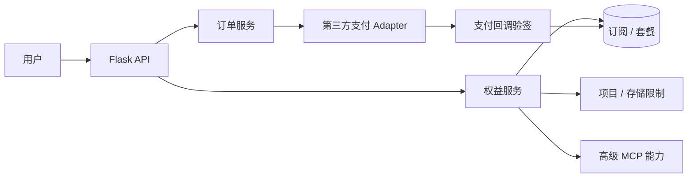

# SketchToUI 架构设计

> 版本：v1.0\
> 更新日期：2026-10-20\
> 需求基线：[产品需求文档](01_PRODUCT_REQUIREMENTS.md) · [数据库表结构](05_DATABASE_SCHEMA.md)

## 1. 架构目标

SketchToUI 的架构首先服务于设计上下文质量，而不是先服务于支付或团队功能。

默认单机运行使用 SQLite、进程内内存缓存和本地 `data/storage`，无需 Redis、MinIO。多实例部署可选择 Redis 共享会话与限流，文件使用共享持久卷或 MinIO；下文公网部署图展示外部依赖方案。内存缓存重启后失效，MCP Token 与项目索引仍在数据库中；Web、MCP 的本地文件目录必须一致。

1. **可信解析**：稳定提取 Sketch 的页面、画板、图层、文本、样式、资源和 Path 数据。
2. **可验证视觉**：用户可通过交互画布、原始预览、画板预览和图层属性判断解析是否正确。
3. **精准 MCP 上下文**：外部 AI 按项目、分组、画板、图层逐层读取，而不是取得无边界的大 JSON。
4. **严格数据隔离**：Web、资源和 MCP 请求只能访问所属用户的数据。
5. **可演进性**：后续增加版本、会员、支付或团队功能时，不推倒解析、画布和 MCP 核心。

## 2. 架构原则

| 原则 | 决策 |
| --- | --- |
| 单一事实来源 | Sketch 原文件和解压内容在本地目录或对象存储；SQLite / MySQL 保存业务索引；内存缓存 / Redis 只保存短期状态。 |
| 分层读取 | UI 与 MCP 都使用“项目 → 分组 → 画板 → 图层”的渐进读取方式。 |
| 视觉优先校验 | 原始 `previews/preview.png`、画板 PNG 与 Canvas 共同验证还原质量。 |
| 权限前置 | 每次对象读取前校验用户、项目、分组和资源归属；Bucket 默认私有。 |
| 前端交互独立 | 视口、选中、悬停与检查器解耦，普通 UI 更新不能重置画布。 |
| MCP 不承担生成 | MCP 提供设计上下文；Codex/Cursor 等外部 AI 负责模型调用和代码生成。 |
| 先功能后商业化 | 会员与支付只能建立在稳定解析、稳定画布和稳定 MCP 上。 |

## 3. 系统上下文图



## 4. 公网部署边界



公网只开放 HTTPS 反向代理。MySQL、Redis、对象存储管理端口、Flask 与 MCP 的真实监听端口均只允许内网或 `127.0.0.1` 访问。

## 5. 逻辑组件图



## 6. 数据职责与对象组织

| 存储 | 保存内容 | 生命周期 | 访问规则 |
| --- | --- | --- | --- |
| SQLite / MySQL | 用户、项目索引、MCP Token、后续版本/订阅/订单 | 长期 | 仅后端服务可访问。 |
| 内存缓存 / Redis | Session、验证码、重发冷却、导入进度、限流 | 短期 | 必须设置 TTL；不保存长期业务事实，内存模式按进程隔离。 |
| 本地目录 / MinIO | 原始 Sketch、解压数据、图片、Canvas JSON、预览图 | 长期 | 私有目录 / Bucket；先校验项目归属。 |
| 本地临时目录 | 上传文件、解压工作区、解析中间文件 | 短期 | 成功、失败或异常后均清理。 |

推荐对象存储前缀：

```text
users/{user-id}/projects/{project-id}/
  source/{original-file}.sketch
  sketch/...
  canvas/manifest.json
  canvas/{group-directory}/canvas.json
  previews/{artboard-id}.png
  versions/{version-id}/...
```

对象路径不能由前端自由拼接后直读；后端必须从当前用户和项目 ID 构造受控前缀。

## 7. 导入与解析数据流



解析必须拆为六层：页面定位、目标页面读取、节点规范化、视觉框计算、资源关联、Canvas/manifest 构建。`meta.json → pagesAndArtboards` 用于定位 Sketch 页面；只读取目标 `pages/{page-id}.json`，不得混入无关页面或画板。

## 8. Web 工作台架构



关键约束：

- 视口状态不依赖目录展开、右侧抽屉、悬停提示等普通 UI 状态；它们不得触发缩放/平移重置。
- 切换画板时仅在明确选中时执行一次初始聚焦；旧异步请求必须被取消或忽略。
- 图层树只接收当前 Artboard 的节点，并使用虚拟列表。
- 右侧检查器只显示单个选中节点的自身数据，默认不递归完整子树。
- 渲染、命中测试、选中框与重叠检测共用统一 `visualFrame` 定义。

## 9. Remote MCP 架构



MCP 采用渐进式读取：项目列表 → 页面分组 → 画板 → 有限深度上下文或单图层 → 预览 PNG / 图片资产 / 设计 Token / 组件摘要。预览和资产使用同一 Bearer Token 权限，不能依赖浏览器 Cookie。

## 10. 解析与视觉质量架构

| 层次 | 作用 | 典型字段 |
| --- | --- | --- |
| 原始事实 | 保留 Sketch 源信息，便于排错和二次解析。 | `sourceFrame`、points、文本 Run、原始 style。 |
| 规范化事实 | 供 Web、MCP、导出共同消费。 | `frame`、`visualFrame`、字体、颜色、资源引用。 |
| 视觉验证事实 | 判断最终显示是否接近设计稿。 | 原始 preview、生成 artboard preview、差异结果。 |

- 文本以 Run 为最小样式单位，综合 `sourceFrame`、段落、行高和垂直对齐计算位置，不能强制所有文本居中。
- Shape Path 保留点、曲线控制点、`curveMode`，再构建正确 SVG Path。
- Bitmap、Symbol 和无法可靠由 Path 重建的图标优先使用 Sketch 引用的资源。
- Canvas 渲染器和画板预览服务应复用颜色、边框、圆角、变换和视觉框计算逻辑。
- 原始预览图是回归参照，不是替代解析数据的最终实现。

## 11. 后续商业化扩展位



会员和支付不进入当前核心数据流。后续仅保留免费版与个人会员（`¥9/月`、`¥96/年`），不销售平台 AI Token，也不把 AI 自动生成代码作为平台可控承诺。

## 12. 架构决策记录

| 编号 | 决策 | 原因 |
| --- | --- | --- |
| ADR-001 | Web 与 API 同一主域名 | 当前前端 API 使用相对路径，降低跨域和 Cookie 复杂度。 |
| ADR-002 | MCP 使用独立子域名 | 便于 Remote MCP 配置、限流、日志和安全边界。 |
| ADR-003 | Bucket 默认私有 | Sketch 资源可能含敏感业务信息。 |
| ADR-004 | 内存缓存 / Redis 保存短期状态 | Session、验证码、任务状态和限流均带 TTL；默认内存，多进程共享时选择 Redis。 |
| ADR-005 | MySQL 保存业务事实 | 用户、项目、Token、版本、订阅和订单必须可迁移和备份。 |
| ADR-006 | 导入采用受限后台任务池 | 当前单机阶段以最少进程实现异步解析；所选缓存保存进度，数据库保存恢复记录，压力出现后再拆分独立 Worker。 |
| ADR-007 | MCP 采用手工 Token | 当前优先保证可用、隔离和启停管理，不实现 OAuth。 |
| ADR-008 | 不销售 AI Token | 平台专注设计上下文，外部 AI 负责模型调用。 |
