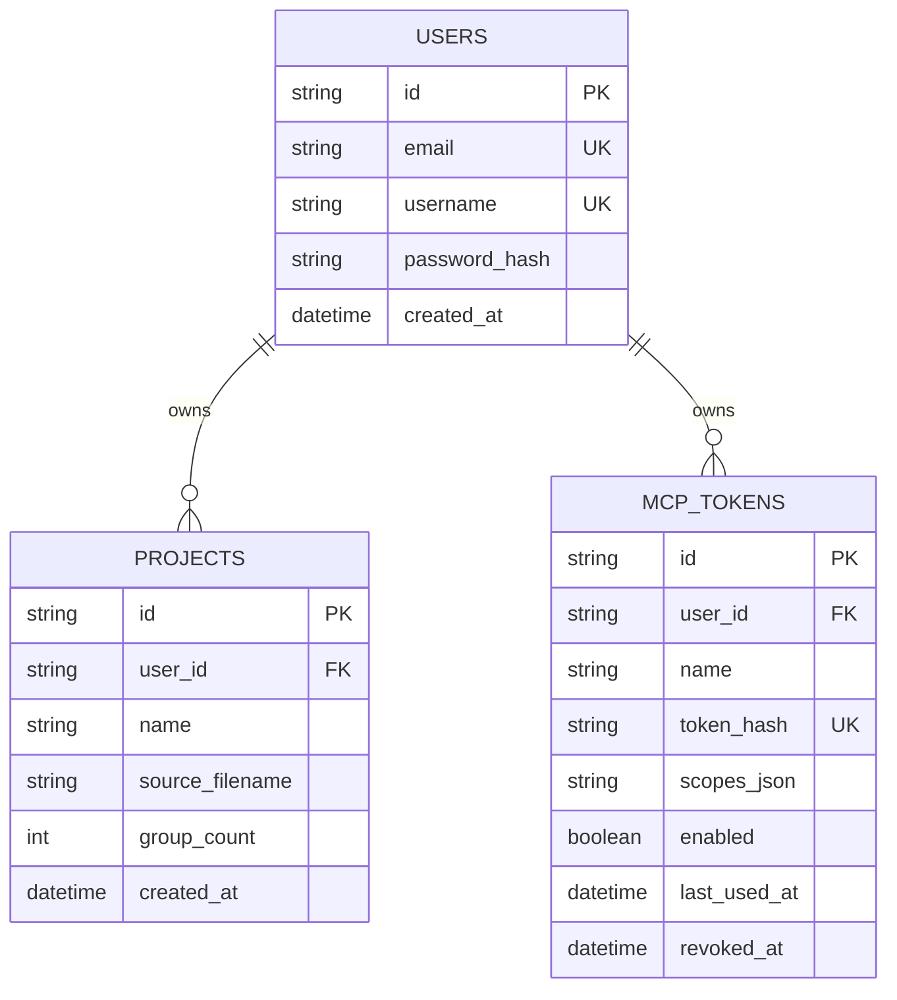
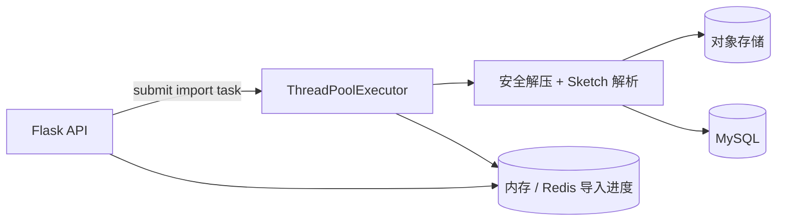

# SketchToUI 技术方案

> 版本：v1.0\
> 更新日期：2026-07-13\
> 相关文档：[产品需求文档](01_PRODUCT_REQUIREMENTS.md) · [架构设计](02_ARCHITECTURE.md) · [数据库表结构](05_DATABASE_SCHEMA.md)

## 1. 实施目标

本方案将当前项目演进为可验证、可扩展的 Sketch 设计上下文平台。实施顺序是：

1. 精确解析目标页面和画板；
2. 稳定、流畅、可检查的 React 画布；
3. 有视觉预览、资源、Token、组件摘要的 Remote MCP；
4. 导入、资源与 MCP 的严格用户隔离；
5. 最后以最小改动增加版本、会员和第三方支付。

## 2. 后端模块设计

### 2.1 分层

```text
backend/
  main.py                    # Flask 入口
  mcp_main.py                # Remote MCP 入口
  manage.py                  # Alembic 管理入口
  app/
    controllers/             # HTTP 协议、参数解析、响应
    services/                # 业务编排与领域能力
    mcp/                     # MCP 验证、限流、Tool/Resource 注册
    common/                  # 数据库、内存/Redis 缓存、本地/MinIO 存储、错误响应
    config/                  # 环境配置
  sketch_to_*.py             # Sketch 解析、分析、转换核心
```

控制器不直接操作对象存储或复杂解析逻辑；认证、项目、资源、MCP Token、预览等能力均通过 Service 层实现。

### 2.2 核心服务职责

| 服务 | 职责 | 输入 | 输出 |
| --- | --- | --- | --- |
| `AuthService` | 注册、验证码、密码验证、Session。 | 邮箱、用户名、密码、验证码。 | 用户与缓存 Session（内存 / Redis）。 |
| `ProjectImportService` | 上传、任务创建、项目查询、删除、对象读取。 | 用户、文件流、项目 ID。 | 项目、导入状态、受控对象内容。 |
| `SketchParser`（目标抽象） | 解压、页面定位、节点规范化、资源关联。 | 解压后的 Sketch 目录。 | 统一设计文档模型。 |
| `CanvasBuilder`（目标抽象） | 平台分类、manifest、Canvas JSON。 | 设计文档模型。 | 分组 Canvas 数据。 |
| `McpDesignService` | 项目/分组/画板/图层/Token/组件上下文。 | 用户、Resource URI、查询条件。 | 有限、精确、可序列化的数据。 |
| `ArtboardPreviewService` | 将规范化 Artboard 渲染为 PNG。 | 用户、项目、分组、画板。 | PNG 字节流。 |
| `McpTokenService` | Token 创建、启停、撤销、验证。 | 用户或 Bearer Token。 | 脱敏 Token 元数据、用户身份。 |
| `EntitlementService`（P2） | 套餐、项目数、存储、功能开关。 | 用户、功能代码。 | 允许/拒绝与限制信息。 |

### 2.3 用户归属校验链

```text
Session / Bearer Token
  → user_id
  → 查询 project.id + project.user_id
  → 校验 group/artboard/layer 属于项目 manifest
  → 组合受控对象存储前缀
  → 读取对象并返回
```

禁止：

- 根据客户端给出的对象存储绝对路径直接下载；
- 仅校验项目 ID 存在、不校验 `user_id`；
- 在 MCP 中依赖浏览器 Cookie 才能读取设计资源；
- 将 Token 原文、对象存储密钥或完整 Session 写入日志。

## 3. 数据模型设计

### 3.1 当前基础表



### 3.2 已实施的版本化扩展（`0002_core_project_versions`）

| 表 | 用途 | 核心字段 |
| --- | --- | --- |
| `project_versions` | 标识重新导入版本、源文件哈希和该版本存储占用。 | `project_id`、`filename`、`source_sha256`、`version_number`、`total_bytes`、`status`。 |
| `import_jobs` | 保留失败原因与耗时；所选缓存保存实时进度。 | `id`、`project_id`、`project_version_id`、`status`、`error_message`。 |

`users` 通过同一轮迁移增加 `phone`、`email_verified`、`email_verified_at`、`status`、`last_login_at` 和 `updated_at`；`projects.source_filename` 重命名为 `filename`。

P2 商业化阶段使用 Alembic 单独新增 `plans`、`subscriptions`、`payment_orders`、`payment_events`；金额统一以分保存，月付 `900`、年付 `9600`。

## 4. 导入任务技术方案

### 4.1 当前阶段要求

Flask API 保存上传文件、写入 `import_jobs` 后提交到进程内 `ThreadPoolExecutor`；解析、保存均在后台任务中执行，所选内存缓存或 Redis 保存实时进度。默认串行解析，可通过 `IMPORT_MAX_WORKERS` 按服务器 CPU/内存情况调整。新建项目先创建逻辑项目与 `v1`；重新导入通过 `POST /api/projects/{project_id}/versions` 创建 `vN`，解析、文件保存全部成功后才将 `projects.current_version_id` 切换到新版本。因此新版本失败时，Web 画布、MCP 和资源读取继续使用原版本。

当前实现已保证：

- 上传大小、ZIP 解压总大小、单文件大小、文件数量和压缩比均有限制；默认分别为 500 MB、2 GB、100 MB、25,000 个条目、150:1，可通过 `.env` 中的 `IMPORT_MAX_*` 配置调整；
- 解压使用流式写入，拒绝 Zip Slip、绝对/盘符路径、符号链接、加密条目和无效 ZIP；
- Canvas 按 Sketch 同级图层的 `hasClippingMask` / `shouldBreakMaskChain` 维护遮罩链，支持矩形、圆形和 Shape Path 遮罩的旋转、翻转与圆角裁剪；
- 无论成功、失败或异常，临时目录均会清理；
- 保存到本地目录或 MinIO 过程中失败时，会清理该失败版本专属对象前缀，不会触碰项目当前可用版本；
- 解析异常写入用户可读的导入失败状态；
- 同一项目旧导入结果不得覆盖新导入中的结果。

### 4.2 后台异步任务实现



当前任务池通过 `IMPORT_MAX_WORKERS` 限制并发，默认值为 `1`，避免大 Sketch 同时占满单机 CPU/内存。Flask 重启时会将 `running` 任务恢复为 `queued` 并尝试继续处理仍存在临时源文件的任务。失败结果会持久化在 `import_jobs` 与 `project_versions`；当单机任务池成为瓶颈时，再替换为独立 Redis Queue / Worker，而不是过早引入额外服务进程。

## 5. Sketch 解析技术方案

### 5.1 统一节点模型

```typescript
type LayerNode = {
  id: string
  name: string
  type: string
  sketchClass: string
  visible: boolean
  locked: boolean
  rotation: number
  flippedHorizontal: boolean
  flippedVertical: boolean
  frame: Frame
  sourceFrame: SourceFrame
  visualFrame: Frame
  style: Style
  text?: TextPayload
  image?: ImageReference
  points?: ShapePoint[]
  children?: LayerNode[]
}
```

节点必须同时保留：

- `sourceFrame`：定位 Sketch 源数据问题；
- `frame`：相对父节点位置；
- `visualFrame`：用于渲染、命中、选中框、重叠检测；
- `text.runs`：字体、颜色、行高、段落与多样式文本；
- `image.reference`：真实图片/图标资源；
- `points`：SVG Path 和曲线验证。

### 5.2 Group 的解析与存储方式

Sketch 中“Group”有两种不同语义，必须分开处理：

| 层级 | Sketch 来源 | 规范化结果 | 保存位置 | 是否建 MySQL 表 |
| --- | --- | --- | --- | --- |
| 页面分组 | `meta.json → pagesAndArtboards` 中的一个页面及其平台切分 | manifest 中的一条 `group`，ID 为 `{page-id}:{platform}` | `canvas/manifest.json` | 否；项目列表读取 manifest 即可。 |
| 图层分组 | `pages/{page-id}.json` 中 `_class: "group"` 的节点 | `type: "group"`、`sketchClass: "group"`、递归 `children` | 对应 Artboard 的 `canvas.json` | 否；它是设计树节点。 |
| 形状分组 | `_class: "shapeGroup"` | `type: "shape_group"`、递归 `children` | 对应 Artboard 的 `canvas.json` | 否；它也是设计树节点。 |
| 设计页面 | `_class: "artboard"` | 根节点 `type: "design_page"` | `canvas.json → designPages` | 否；属于画板根节点。 |

原始解析规则：只要原始节点包含 `layers` 数组，解析器就递归生成 `children`。因此普通 Group、Shape Group、Symbol Master 等容器都可以保留层级；`_class` 决定 `type`，`layers` 决定子节点树。

目标规范化节点需补充以下 Group 专用字段：

```typescript
type GroupNodeExtensions = {
  parentId?: string
  childCount: number
  isMask?: boolean
  clippingMaskMode?: number
  hasClickThrough?: boolean
  resizingConstraint?: number
}
```

其中 `parentId` 用于从任意图层反向定位所属 Group；`childCount` 用于 MCP 有限深度输出和虚拟树；遮罩/裁剪字段用于修复“JSON 正确但画布视觉不正确”的分组场景。

**查找一个已解析 Group 的路径**：

```text
project-id
  → manifest.group-id（页面分组）
  → canvas/{directory}/canvas.json
  → designPages[artboard-id]
  → 递归查找 node.id 或 node.type == "group"
```

Web 前端在当前画板图层树中直接按节点 ID 查找；MCP 使用 `find_layers` 按名称/类型检索，或 `get_layer(project_id, group_id, layer_id)` 读取一个 Group 自身数据。读取完整 Group 子树时使用画板的 `get_design_context(resource, depth, max_nodes)`，不能默认把所有子图层展开。

### 5.3 平台分类算法

```text
遍历 meta.pagesAndArtboards：
  页面名称为“插件”或“插件版” → plugin
  否则遍历 Artboard：
    名称以 H5 开头 → mobile
    其他 → desktop

manifest.group.id = "{page-id}:{platform}"
manifest.group.platform = desktop | mobile | plugin
```

历史 manifest 中名称为 `插件 · 电脑端` 的记录，前端应继续识别为 `plugin`，无需重新导入。

### 5.4 文本、Path 与资源策略

**文本**

1. 以 Text Run 为样式最小单位；多 Run 时按 Run 分段或明确降级。
2. 基于 `sourceFrame`、行高、段落对齐与垂直对齐计算基线，不能把所有文本强制居中。
3. 同时保存 CSS 导出值和实际视觉位置，排查“字段正确、显示错误”。
4. 用 `44C8916C-...`、`F2EE4382-...`、`20B4EA36-...` 作为文本回归样本。

**Shape Path 与图标**

1. 将 `{x, y}` 点字符串转换为归一化数值坐标。
2. 根据 `curveMode`、`curveFrom`、`curveTo` 构建直线、贝塞尔曲线或闭合 Path。
3. 根据 fill/border 输出 SVG 样式，需要时写独立 SVG 供调试。
4. 对 Symbol、Bitmap 和复杂基础图标，优先读取资源引用，不能错误降级为线段。
5. 使用 `4204D8BA-...`、`F0BDBB61-...`、`842780F4-...` 做回归验证。

## 6. React Canvas 技术方案

### 6.1 状态边界

| 状态域 | 数据 | 更新原则 |
| --- | --- | --- |
| 工作区 | 当前项目、分组、画板。 | 画板切换时才加载新 Canvas 数据。 |
| 选择 | `selectedLayerId`、`activeArtboardId`。 | 画布点击与图层树点击双向同步。 |
| 视口 | `scale`、`translateX`、`translateY`。 | 只由手势、快捷键、显式聚焦/适应窗口更新。 |
| 悬停 | 图层 ID、鼠标位置。 | 轻量更新，不能影响视口。 |
| UI | 左右抽屉、展开分组、Dialog。 | 不得触发 Canvas 重新聚焦。 |

### 6.2 渲染与性能

- CanvasStage 可使用 DOM/SVG/Canvas 混合渲染，但必须共用视觉框与坐标换算。
- 大量图层使用视口裁剪和按需渲染；图层树始终使用虚拟列表。
- 选中框、PX 标注、网格和参考线属于覆盖层，不修改原图层布局。
- 切换页面时使用 `AbortController` 或请求序号，阻止旧响应覆盖新选择。

### 6.3 交互验收

- Ctrl/⌘ + 滚轮缩放画布；拖拽平移；工具栏/快捷键适应窗口。
- 选中图层后显示边框、宽高、X/Y；右侧仅显示图层自身数据。
- 鼠标离开画布、展开分组、打开检查器或加载预览，均不能重置缩放比例。

## 7. MCP 技术方案

### 7.1 鉴权与限流

```text
Authorization: Bearer skt_...
  → SHA-256 哈希查询 mcp_tokens
  → 检查 enabled、revoked_at、所属 user_id
  → 所选缓存的全局 + Token 限流（内存模式仅限当前 MCP 进程）
  → 执行 Tool / Resource
```

Token 原文仅在创建成功时返回一次；数据库只保存 Hash 和前缀。

### 7.2 Tool / Resource 返回策略

| 类型 | 返回原则 |
| --- | --- |
| 目录 Tool | 只返回 ID、名称、平台、数量和必要摘要。 |
| 画板上下文 | 支持 `depth`、`max_nodes`，避免超大响应。 |
| 单图层 | 返回自身样式、文本、资源和 Frame，不默认返回完整子树。 |
| 图片/预览 | 返回 Bearer Token 保护的 MCP Image 内容。 |
| 设计 Token | 返回聚合结果与使用次数，不丢失原始颜色/字体信息。 |
| 组件摘要 | 返回候选、出现次数、代表节点与限制说明。 |

### 7.3 Resource URI 规范

```text
sketchtoui://projects
sketchtoui://projects/{project-id}
sketchtoui://projects/{project-id}/groups/{group-id}
sketchtoui://projects/{project-id}/groups/{group-id}/artboards/{artboard-id}
sketchtoui://projects/{project-id}/groups/{group-id}/layers/{layer-id}
sketchtoui://projects/{project-id}/groups/{group-id}/artboards/{artboard-id}/preview
```

URI 参数全部 URL 编码；服务端解析 URI 后必须再次校验项目归属。

## 8. API 与错误响应

| 领域 | 主要接口 | 规则 |
| --- | --- | --- |
| 认证 | `/api/auth/*` | JSON 响应；Session Cookie；验证码只在带 TTL 的内存缓存 / Redis。 |
| 项目 | `/api/projects`、`/api/imports/{job-id}` | 导入返回 `202 + jobId`；前端轮询进度。 |
| 画布 | `/api/projects/{id}/manifest`、`/canvas/...` | 每次读取先校验项目归属。 |
| 资源 | `/api/projects/{id}/assets/...` | 使用受控相对路径，不接受对象存储绝对路径。 |
| MCP Token | `/api/mcp/tokens`、`/api/mcp/config` | 返回脱敏 Token 信息和 Remote URL。 |
| 后续计费 | `/api/billing/*` | 只有支付回调验签后才能更新权益。 |

统一错误格式：

```json
{ "error": "用户可读的错误消息" }
```

前端封装必须先判断 Content-Type 和 HTTP 状态再解析 JSON，避免 HTML 错页触发 `Unexpected token '<'`。

## 9. 质量、测试与指标

| 层级 | 验证目标 |
| --- | --- |
| 解析单元测试 | Frame、Text Run、颜色、Path、资源引用、平台分类。 |
| Fixture 回归测试 | UUID、预览图、目录分组、manifest 输出固定断言。 |
| API 集成测试 | 注册、缓存验证码、项目归属、资源读取、Token 启停、跨用户拒绝；无外部服务的内存 / 本地存储闭环。 |
| MCP 集成测试 | Bearer 鉴权、URI 编码、预览图片、限流、跨项目访问拒绝。 |
| 前端交互测试 | 画板切换、视口保持、图层虚拟化、选中同步。 |

P0 必须记录：导入成功率与阶段耗时、源文件/解压大小、项目图层数、MCP 工具名和耗时、429 数、鉴权失败数、预览生成耗时、API 与对象存储错误。

## 10. 实施路线

### 阶段 A：解析与画布（P0）

1. 固化 Fixture、UUID 回归样本和预览对比。
2. 修复文本基线/对齐、Shape Path、Symbol/图片资源引用。
3. 稳定平台目录、画板切换、视口、选中、悬停与检查器。
4. 图层树只显示当前画板并完成虚拟化。

### 阶段 B：MCP 设计上下文（P0/P1）

1. 固化项目、分组、画板、图层 Resource 的权限与 URI。
2. 完成画板预览、资产读取与图片返回。
3. 完成设计 Token、组件摘要、文本检查和重叠检查。
4. 提供当前画板 MCP 链接与接入指引。

### 阶段 C：可靠导入与版本（P1）

1. 已实现 Flask 内置异步任务池和中断任务恢复；出现单机压力后再迁移为独立 Redis Worker。
2. 已增加压缩包防护、临时目录治理；后续补充失败自动重试。
3. 已完成源文件 Hash、导入版本、存储用量和成功后版本切换；后续补充失败重试与版本保留策略。

### 阶段 D：个人版商业化（P2）

1. 增加套餐、订阅、订单、第三方支付 Adapter 与 Webhook 验签。
2. 引入 `EntitlementService`，统一控制项目数、存储和高级 MCP 能力。
3. 上线免费版与 `¥9/月`、`¥96/年` 个人会员，根据真实成本调整额度。

## 11. 当前不应实施的技术项

- 未选定支付服务商前，不编写具体支付 SDK 与回调；
- OAuth 2.1、动态客户端注册与网页登录授权；
- 企业多租户、SSO、私有部署和复杂成员角色；
- 自建模型、平台 AI Token 计费或承诺 AI 代码质量；
- 为尚未出现的流量过早拆分大量微服务。

当前保持“模块化单体 + 独立 MCP + 内置导入任务池”的架构：部署简单、职责清晰，足以支撑功能验证，也可以按需要拆分。
