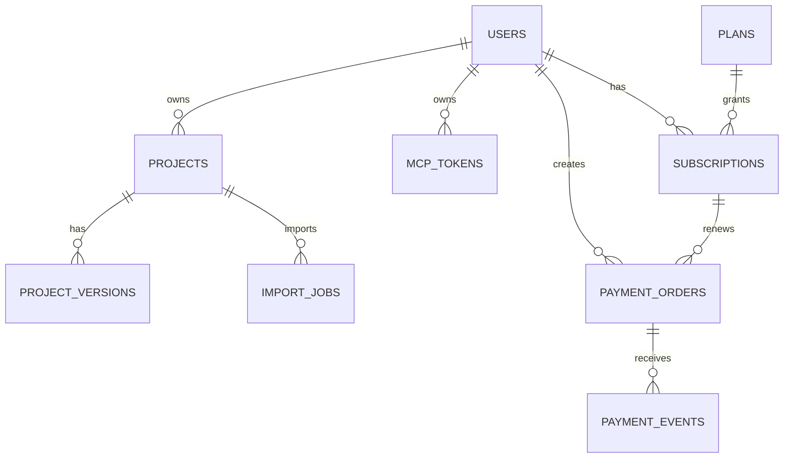

# SketchToUI 数据库表结构设计

> 版本：v1.0\
> 更新日期：2026-07-13\
> 关联文档：[产品需求](01_PRODUCT_REQUIREMENTS.md) · [架构设计](02_ARCHITECTURE.md) · [技术方案](03_TECHNICAL_SOLUTION.md)

## 1. 设计目标与数据边界

SQLite / MySQL 保存可追溯、需要查询和需要迁移的业务事实；内存缓存 / Redis 保存带 TTL 的短期状态；本地目录 / MinIO 保存 Sketch 文件、Canvas JSON、图片和预览等大对象。默认单机模式无需 Redis、MinIO。

| 数据 | 正确位置 | 不应放入 |
| --- | --- | --- |
| 用户、项目、版本、MCP Token、订阅、订单 | MySQL | Redis、对象存储文件名推导。 |
| 登录 Session、邮箱验证码、重发冷却、限流计数、实时导入进度 | 内存缓存 / Redis | MySQL 业务表。 |
| `.sketch` 原文件、解压内容、图片、SVG、Canvas JSON、PNG 预览 | 本地目录 / MinIO | MySQL BLOB、缓存。 |

**明确约束**：邮箱验证码不得创建数据库表；它只存在所选缓存，10 分钟后自动过期。内存模式重启后 Session、验证码失效；持久导入记录可从数据库恢复。MCP Token 原文不得落库；数据库仅保存 SHA-256 Hash 和安全前缀。

## 2. 通用字段规范

| 规则 | 设计 |
| --- | --- |
| 主键 | `CHAR(32)`，使用 `uuid.uuid4().hex`；不使用自增 ID。 |
| 字符集 | MySQL 使用 `utf8mb4`，排序规则建议 `utf8mb4_0900_ai_ci` 或服务端兼容的 `utf8mb4_unicode_ci`。 |
| 时间 | 当前项目已使用 UTC ISO-8601 字符串，类型为 `VARCHAR(40)`；新增表在当前兼容阶段保持相同规则。后续统一迁移为 `DATETIME(6)` 时，不与旧表混用。 |
| 金额 | 使用整数“分”，例如月付 `900`、年付 `9600`；禁止 `float`。 |
| 布尔值 | MySQL 使用 `TINYINT(1)` / SQLAlchemy Boolean，值为 `0` 或 `1`。 |
| 枚举 | 业务状态使用 `VARCHAR(32)` + 应用层白名单，避免 MySQL ENUM 造成跨库迁移困难。 |
| JSON | 需要 SQLite 兼容或查询较少时保存为 `TEXT` JSON；不在 MySQL/SQLite 之间混用专有 JSON 查询。 |
| 删除 | Token 采用撤销时间软删除；订单和支付事件不物理删除；项目删除必须先删除对象存储前缀。 |

## 3. 实体关系图



## 4. 当前已实现表

代码已包含 `0001_initial_schema` 与 `0002_core_project_versions`。新环境执行 `python backend/manage.py db upgrade` 后，业务表为 `users`、`projects`、`project_versions`、`import_jobs`、`mcp_tokens`；另有 Alembic 自动维护的 `alembic_version`。现有数据库仍停留在 `0001` 时，必须升级后才能启动新版后端。

### 4.1 `users`

用途：登录身份和账户基本资料。

| 字段 | 类型 | 空 | 默认值 | 约束 / 索引 | 含义 |
| --- | --- | --- | --- | --- | --- |
| `id` | `CHAR(32)` | 否 | - | 主键 | 用户 UUID Hex。 |
| `email` | `VARCHAR(320)` | 否 | - | 唯一索引 | 登录邮箱，建议应用层统一 trim/lowercase。 |
| `username` | `VARCHAR(64)` | 否 | - | 唯一索引 | 用户名，当前约束为字母、数字、下划线、短横线。 |
| `password_hash` | `TEXT` | 否 | - | - | 密码 Hash，禁止存储明文。 |
| `created_at` | `VARCHAR(40)` | 否 | - | - | UTC ISO-8601 创建时间。 |

当前 SQLAlchemy/Alembic 逻辑已具备 `email` 和 `username` 唯一约束。注册流程校验缓存中验证码成功后才创建用户，验证码本身不落库。

`0002` 已追加的用户字段：

| 字段 | 类型 | 空 | 默认值 | 约束 / 索引 | 含义 |
| --- | --- | --- | --- | --- | --- |
| `phone` | `VARCHAR(32)` | 是 | `NULL` | 唯一索引 | 冗余保存的手机号；当前不作为强制登录方式。MySQL 唯一索引允许多个 `NULL`。 |
| `email_verified` | `BOOLEAN` | 否 | `0` | `idx_users_email_verified` | 邮箱是否已激活。 |
| `email_verified_at` | `VARCHAR(40)` | 是 | `NULL` | - | 邮箱最近一次激活成功时间。 |
| `status` | `VARCHAR(32)` | 否 | `active` | `idx_users_status` | `active` / `disabled` / `deleted`。禁用用户不能登录、导入或调用 MCP。 |
| `last_login_at` | `VARCHAR(40)` | 是 | `NULL` | - | 最近一次密码登录成功时间。 |
| `updated_at` | `VARCHAR(40)` | 否 | - | - | 用户资料、状态或激活状态更新时间。 |

邮箱验证码仍只存在带 TTL 的内存缓存 / Redis；`email_verified` / `email_verified_at` 只保存“账户激活结果”，不保存验证码本身。

### 4.2 `projects`

用途：用户导入的 Sketch 项目业务索引；大型解析数据不在此表保存。

| 字段 | 类型 | 空 | 默认值 | 约束 / 索引 | 含义 |
| --- | --- | --- | --- | --- | --- |
| `id` | `CHAR(32)` | 否 | - | 主键 | 项目 UUID Hex。 |
| `user_id` | `CHAR(32)` | 否 | - | `idx_projects_user` | 所属用户；所有项目读取必须使用 `id + user_id`。 |
| `name` | `VARCHAR(255)` | 否 | - | - | 用户可见项目名称。 |
| `filename` | `VARCHAR(512)` | 否 | - | - | 当前成功版本的上传文件名，仅作显示。 |
| `group_count` | `INT` | 否 | - | - | 解析生成的非空 Canvas 分组数。 |
| `current_version_id` | `CHAR(32)` | 是 | `NULL` | - | 当前对 Web、MCP 和资源读取生效的项目版本。 |
| `status` | `VARCHAR(32)` | 否 | `ready` | `idx_projects_user_status` | `importing` / `ready` / `failed`。已有可用版本重新导入时保持 `ready`。 |
| `created_at` | `VARCHAR(40)` | 否 | - | - | 项目创建时间。 |
| `updated_at` | `VARCHAR(40)` | 否 | - | - | 当前版本成功切换或项目状态变更时间。 |

逻辑项目对象存储前缀固定为：

```text
users/{user_id}/projects/{project_id}/versions/{project_version_id}/
```

每个 `project_versions.object_prefix` 保存受服务端生成的版本前缀；前端与 MCP 只能经由当前版本指针读取，不能传入任意对象路径。

### 4.2.1 为什么不建立 `groups`、`artboards`、`layers` 数据表

当前不建立这些表，原因如下：

- Sketch 一个项目可包含数千至数万图层；将完整递归图层树拆入 MySQL 会显著增加导入写入、版本复制和查询复杂度。
- 页面分组、Artboard 和图层 Group 是随一次 Sketch 导入版本变化的设计数据，不是独立业务实体。
- Canvas JSON 已天然保存递归层级、样式、文本、Path 和资源引用；Web 和 MCP 都可以按画板按需读取。
- MySQL 只保存项目、版本、导入任务和权限索引；对象存储保存 `canvas/manifest.json` 与各分组 `canvas.json`。

当需要定位一个 Group 时，使用：`project_id → current_version_id → manifest group_id → artboard_id → layer_id`。图层 Group 的 `_class: group` / `type: group` 保存在 Canvas JSON 中，而不是关系表。

**`0002` 必须调整的项目字段**：

| 变更 | 设计 |
| --- | --- |
| 重命名 | 将现有 `source_filename` 重命名为 `filename`；它仍仅用于展示和导入记录，不参与对象路径拼接。 |
| 新增 `current_version_id` | `CHAR(32)` nullable；指向当前供 Web 与 MCP 默认读取的成功版本。 |
| 新增 `status` | `VARCHAR(32)`，取值 `ready` / `importing` / `failed` / `deleting`。 |
| 新增 `updated_at` | 最近导入、重命名或状态变化时间。 |

### 4.3 `mcp_tokens`

用途：Remote MCP Bearer Token 的安全元数据和启停状态。

| 字段 | 类型 | 空 | 默认值 | 约束 / 索引 | 含义 |
| --- | --- | --- | --- | --- | --- |
| `id` | `CHAR(32)` | 否 | - | 主键 | Token 记录 ID。 |
| `user_id` | `CHAR(32)` | 否 | - | `idx_mcp_tokens_user` | Token 所属用户。 |
| `name` | `VARCHAR(120)` | 否 | - | - | 用户可读名称，如 `Codex Remote MCP`。 |
| `token_prefix` | `VARCHAR(24)` | 否 | - | - | 仅用于列表识别的安全前缀。 |
| `token_hash` | `CHAR(64)` | 否 | - | 唯一索引 | `SHA-256(token)`；绝不保存原 Token。 |
| `scopes_json` | `TEXT` | 否 | - | - | 当前授权范围 JSON。 |
| `created_at` | `VARCHAR(40)` | 否 | - | - | 创建时间。 |
| `last_used_at` | `VARCHAR(40)` | 是 | `NULL` | - | 最近一次验证成功时间。 |
| `expires_at` | `VARCHAR(40)` | 是 | `NULL` | - | 兼容字段；当前产品默认不设置过期时间。 |
| `revoked_at` | `VARCHAR(40)` | 是 | `NULL` | 建议索引参与查询 | 撤销时间，非空则禁止使用。 |
| `enabled` | `BOOLEAN` | 否 | `1` | - | 用户手动启用/禁用状态。 |

认证查询必须同时满足：`token_hash` 匹配、`enabled = 1`、`revoked_at IS NULL`，以及所属用户存在。Token 只能访问该用户的项目。

### 4.4 `alembic_version`

用途：Alembic 自动管理，记录已应用的最后一个迁移版本。业务代码不得手工修改此表。

## 5. P1：项目版本与导入表（当前必须新增）

### 5.1 `project_versions`

用途：记录同一项目每次重新导入的 Sketch 文件与解析产物版本。当前 `projects` 表代表逻辑项目，`project_versions` 代表具体导入版本。

| 字段 | 类型 | 空 | 默认值 | 索引 | 含义 |
| --- | --- | --- | --- | --- | --- |
| `id` | `CHAR(32)` | 否 | - | PK | 版本 ID。 |
| `project_id` | `CHAR(32)` | 否 | - | `idx_project_versions_project_number` | 逻辑项目。 |
| `version_number` | `INT` | 否 | - | `UNIQUE(project_id, version_number)` | 从 1 递增。 |
| `filename` | `VARCHAR(512)` | 否 | - | - | 本次导入文件名。 |
| `source_sha256` | `CHAR(64)` | 否 | - | `idx_project_versions_sha` | 原始 `.sketch` SHA-256。 |
| `source_bytes` | `BIGINT` | 否 | `0` | - | 原文件大小。 |
| `extracted_bytes` | `BIGINT` | 否 | `0` | - | 解压后的 Sketch 内容大小。 |
| `canvas_bytes` | `BIGINT` | 否 | `0` | - | Canvas JSON 与 manifest 大小。 |
| `preview_bytes` | `BIGINT` | 否 | `0` | - | 已缓存画板预览大小。 |
| `total_bytes` | `BIGINT` | 否 | `0` | `idx_project_versions_total_bytes` | 当前版本对象存储总占用。 |
| `object_prefix` | `VARCHAR(512)` | 否 | - | 唯一 | 该版本受控对象前缀。 |
| `status` | `VARCHAR(32)` | 否 | `pending` | `idx_project_versions_status` | `pending` / `processing` / `ready` / `failed` / `deleted`。 |
| `manifest_path` | `VARCHAR(1024)` | 是 | `NULL` | - | Canvas manifest 的相对路径。 |
| `group_count` | `INT` | 否 | `0` | - | 非空页面分组数量。 |
| `artboard_count` | `INT` | 否 | `0` | - | 设计页面总数。 |
| `layer_count` | `INT` | 否 | `0` | - | 图层总数。 |
| `error_code` | `VARCHAR(64)` | 是 | `NULL` | - | 机器可读失败代码。 |
| `error_message` | `TEXT` | 是 | `NULL` | - | 用户可读失败原因。 |
| `created_at` | `VARCHAR(40)` | 否 | - | - | 创建时间。 |
| `completed_at` | `VARCHAR(40)` | 是 | `NULL` | - | 成功或失败结束时间。 |

切换当前版本时必须是原子操作：只有 `project_versions.status = ready` 的版本才能成为 `current_version_id`。

### 5.2 `import_jobs`

用途：持久化记录导入任务。所选缓存用于前端实时进度；此表用于重启恢复、失败排查和历史记录。

| 字段 | 类型 | 空 | 默认值 | 索引 | 含义 |
| --- | --- | --- | --- | --- | --- |
| `id` | `CHAR(32)` | 否 | - | PK | 导入任务 ID。 |
| `user_id` | `CHAR(32)` | 否 | - | `idx_import_jobs_user_created` | 发起导入用户。 |
| `project_id` | `CHAR(32)` | 否 | - | `idx_import_jobs_project` | 对应逻辑项目。 |
| `project_version_id` | `CHAR(32)` | 否 | - | 唯一 | 对应导入版本。 |
| `status` | `VARCHAR(32)` | 否 | `queued` | `idx_import_jobs_status` | `queued` / `running` / `succeeded` / `failed` / `canceled`。 |
| `stage` | `VARCHAR(32)` | 否 | `uploading` | - | `uploading` / `extracting` / `parsing` / `rendering` / `storing`。 |
| `progress` | `TINYINT UNSIGNED` | 否 | `0` | - | 0–100，仅作持久快照。 |
| `message` | `VARCHAR(255)` | 否 | `''` | - | 当前阶段对用户显示的进度文本。 |
| `attempt` | `SMALLINT` | 否 | `0` | - | 已重试次数。 |
| `worker_id` | `VARCHAR(128)` | 是 | `NULL` | - | 当前处理后台任务所属的 Flask 进程标识；字段为后续独立 Worker 兼容保留。 |
| `error_code` | `VARCHAR(64)` | 是 | `NULL` | - | 失败分类。 |
| `error_message` | `TEXT` | 是 | `NULL` | - | 失败详情。 |
| `created_at` | `VARCHAR(40)` | 否 | - | - | 创建时间。 |
| `started_at` | `VARCHAR(40)` | 是 | `NULL` | - | 实际开始时间。 |
| `finished_at` | `VARCHAR(40)` | 是 | `NULL` | - | 结束时间。 |

一个 `project_version_id` 同一时间只允许一个活动任务；可通过应用层约束或唯一条件保证。

版本大小统计直接保存在 `project_versions`，不再创建一对一的 `project_storage` 表。用户总用量在需要时用当前/有效版本的 `total_bytes` 聚合计算。

## 6. P2：套餐、订阅与支付表

### 6.1 `plans`

用途：平台套餐定义。初期仅保留 `free` 和 `personal` 两条启用记录。

| 字段 | 类型 | 空 | 默认值 | 约束 / 索引 | 含义 |
| --- | --- | --- | --- | --- | --- |
| `id` | `CHAR(32)` | 否 | - | PK | 套餐记录 ID。 |
| `code` | `VARCHAR(32)` | 否 | - | 唯一 | `free` / `personal`。 |
| `name` | `VARCHAR(64)` | 否 | - | - | 用户可见名称。 |
| `monthly_price_fen` | `INT` | 否 | `0` | - | 月付价格，个人会员为 `900`。 |
| `yearly_price_fen` | `INT` | 否 | `0` | - | 年付价格，个人会员为 `9600`。 |
| `limits_json` | `TEXT` | 否 | - | - | 项目数、存储、Token 数、高级 MCP 能力配置。 |
| `enabled` | `BOOLEAN` | 否 | `1` | - | 是否允许新购。 |
| `sort_order` | `SMALLINT` | 否 | `0` | - | 前端排序。 |
| `created_at` | `VARCHAR(40)` | 否 | - | - | 创建时间。 |
| `updated_at` | `VARCHAR(40)` | 否 | - | - | 修改时间。 |

`limits_json` 示例：

```json
{
  "maxProjects": 20,
  "maxStorageBytes": 10737418240,
  "maxMcpTokens": 5,
  "features": ["artboard_preview", "design_asset", "design_tokens", "components"]
}
```

### 6.2 `subscriptions`

用途：用户当前和历史会员权益。免费用户可不建记录，由 `free` 默认权益推导；也可统一创建一条 `free` 订阅，二者只能选一种实现并坚持。

| 字段 | 类型 | 空 | 默认值 | 索引 | 含义 |
| --- | --- | --- | --- | --- | --- |
| `id` | `CHAR(32)` | 否 | - | PK | 订阅 ID。 |
| `user_id` | `CHAR(32)` | 否 | - | `idx_subscriptions_user_status` | 所属用户。 |
| `plan_id` | `CHAR(32)` | 否 | - | - | 对应套餐。 |
| `status` | `VARCHAR(32)` | 否 | `active` | `idx_subscriptions_status_expires` | `active` / `expired` / `canceled` / `pending`。 |
| `billing_cycle` | `VARCHAR(16)` | 否 | - | - | `monthly` / `yearly` / `free`。 |
| `started_at` | `VARCHAR(40)` | 否 | - | - | 权益起始时间。 |
| `expires_at` | `VARCHAR(40)` | 是 | `NULL` | - | 到期时间；免费可为空。 |
| `canceled_at` | `VARCHAR(40)` | 是 | `NULL` | - | 手动取消时间。 |
| `source_order_id` | `CHAR(32)` | 是 | `NULL` | - | 开通/续费来源订单。 |
| `created_at` | `VARCHAR(40)` | 否 | - | - | 创建时间。 |
| `updated_at` | `VARCHAR(40)` | 否 | - | - | 更新时间。 |

“当前有效会员”查询规则：`status = active AND (expires_at IS NULL OR expires_at > now)`，按 `expires_at` 最新记录取一条。

### 6.3 `payment_orders`

用途：用户发起的每次第三方支付订单。前端跳转成功或轮询结果不能直接开通权益，只有支付回调验签成功可更新订单。

| 字段 | 类型 | 空 | 默认值 | 索引 | 含义 |
| --- | --- | --- | --- | --- | --- |
| `id` | `CHAR(32)` | 否 | - | PK | 本地订单 ID。 |
| `order_no` | `VARCHAR(64)` | 否 | - | 唯一 | 给第三方支付的商户订单号。 |
| `user_id` | `CHAR(32)` | 否 | - | `idx_orders_user_created` | 付款用户。 |
| `plan_id` | `CHAR(32)` | 否 | - | - | 下单时的套餐快照来源。 |
| `subscription_id` | `CHAR(32)` | 是 | `NULL` | - | 支付成功后关联订阅。 |
| `billing_cycle` | `VARCHAR(16)` | 否 | - | - | `monthly` / `yearly`。 |
| `amount_fen` | `INT` | 否 | - | - | 应付金额：`900` 或 `9600`。 |
| `currency` | `CHAR(3)` | 否 | `CNY` | - | 币种。 |
| `provider` | `VARCHAR(32)` | 否 | - | `idx_orders_provider_no` | 第三方支付供应商代码。 |
| `provider_order_id` | `VARCHAR(128)` | 是 | `NULL` | - | 对方订单号。 |
| `status` | `VARCHAR(32)` | 否 | `pending` | `idx_orders_status_created` | `pending` / `paid` / `closed` / `refunded` / `failed`。 |
| `payment_url` | `TEXT` | 是 | `NULL` | - | 短期支付 URL；过期后不可复用。 |
| `expires_at` | `VARCHAR(40)` | 是 | `NULL` | - | 支付订单关闭时间。 |
| `paid_at` | `VARCHAR(40)` | 是 | `NULL` | - | 第三方确认付款时间。 |
| `created_at` | `VARCHAR(40)` | 否 | - | - | 创建时间。 |
| `updated_at` | `VARCHAR(40)` | 否 | - | - | 更新时间。 |

### 6.4 `payment_events`

用途：支付平台 Webhook 原始事件的幂等处理记录。任何支付回调先写入或确认此表，再更新订单和订阅。

| 字段 | 类型 | 空 | 默认值 | 约束 / 索引 | 含义 |
| --- | --- | --- | --- | --- | --- |
| `id` | `CHAR(32)` | 否 | - | PK | 事件记录 ID。 |
| `provider` | `VARCHAR(32)` | 否 | - | - | 支付供应商代码。 |
| `provider_event_id` | `VARCHAR(128)` | 否 | - | `UNIQUE(provider, provider_event_id)` | 防止重复回调。 |
| `payment_order_id` | `CHAR(32)` | 是 | `NULL` | `idx_events_order` | 对应本地订单。 |
| `event_type` | `VARCHAR(64)` | 否 | - | - | 如 `payment_succeeded`。 |
| `signature_valid` | `BOOLEAN` | 否 | `0` | - | 回调签名是否验证成功。 |
| `payload_json` | `TEXT` | 否 | - | - | 原始回调 JSON；按供应商敏感字段策略脱敏。 |
| `processed_at` | `VARCHAR(40)` | 是 | `NULL` | - | 成功处理时间。 |
| `failure_reason` | `VARCHAR(255)` | 是 | `NULL` | - | 验签、订单匹配或处理失败原因。 |
| `created_at` | `VARCHAR(40)` | 否 | - | - | 收到回调时间。 |

处理事务顺序：验签 → 以唯一键锁定/插入事件 → 锁定订单 → 校验金额与套餐 → 更新订单为 `paid` → 延长/创建订阅 → 标记事件已处理。重复 Webhook 返回成功但不重复续期。

## 7. 索引、关系与删除策略

### 7.1 推荐索引

| 表 | 索引 | 用途 |
| --- | --- | --- |
| `projects` | `(user_id, created_at)` | 用户项目列表。 |
| `projects` | `(user_id, status)` | 当前可用项目查询。 |
| `project_versions` | `(project_id, version_number)` unique | 查最新/指定版本。 |
| `import_jobs` | `(status, created_at)` | 恢复与查询排队导入任务。 |
| `mcp_tokens` | `token_hash` unique | Bearer Token 鉴权。 |
| `mcp_tokens` | `(user_id, revoked_at, enabled)` | 用户 Token 管理。 |
| `subscriptions` | `(user_id, status, expires_at)` | 当前权益判断。 |
| `payment_orders` | `order_no` unique | 第三方支付对账。 |
| `payment_events` | `(provider, provider_event_id)` unique | Webhook 幂等。 |

### 7.2 外键策略

- 逻辑上所有 `*_id` 都有关联关系。
- 新 MySQL 迁移建议显式创建外键，但保留应用层归属校验；外键不能替代权限控制。
- `projects.user_id → users.id`、`mcp_tokens.user_id → users.id` 等关系建议使用 `RESTRICT`，避免误删用户时留下对象存储孤儿数据。
- 删除项目的顺序：标记 `deleting` → 删除对象存储前缀 → 删除/标记版本与任务 → 删除项目行。
- 删除用户的功能后置；在具备订单、支付、审计后默认应做匿名化或逻辑删除，而不是级联物理删除。

## 8. 缓存 Key 设计（内存 / Redis，非 MySQL 表）

| Key 模式 | TTL | 用途 |
| --- | --- | --- |
| `session:{session-id}` | `SESSION_DAYS` | Session ID → user ID。 |
| `verify:{email}` | 10 分钟 | 注册验证码、尝试次数。 |
| `verify:cooldown:{email}` | 60 秒 | 重发验证码冷却。 |
| `import:{job-id}` | 24 小时或任务后短期保留 | 实时导入进度。 |
| `mcp:rate:global:{window}` | 约 60 秒 | MCP 全局限流。 |
| `mcp:rate:token:{hash}:{window}` | 约 60 秒 | MCP 单 Token 限流。 |

缓存 Key 不得包含密码、Token 原文、对象存储密钥或整份 Canvas JSON。

## 9. Alembic 迁移规划

| 迁移 | 内容 | 前置条件 |
| --- | --- | --- |
| `0001_initial_schema` | `users`、`projects`、`mcp_tokens`。 | 已存在。 |
| `0002_core_project_versions` | 增加用户激活/状态/登录字段；重命名 `projects.source_filename` 为 `filename`；增加项目状态/当前版本、`project_versions`、`import_jobs` 和索引。 | 已实现；部署前执行 `python backend/manage.py db upgrade`。 |
| `0003_billing` | `plans`、`subscriptions`、`payment_orders`、`payment_events`。 | 确定第三方支付供应商。 |

迁移规则：

1. 每次表结构变化必须新增 Alembic Revision，不通过应用启动时自动 `CREATE TABLE` 修改生产表。
2. 迁移必须同时提供 `upgrade()` 与可行的 `downgrade()`；不可逆数据迁移需在 Revision 注释中明确。
3. 先在 SQLite Fixture 和 MySQL 测试库验证，再运行生产 `python backend/manage.py db upgrade`。
4. 不修改已经上线的历史迁移文件；任何修正都创建新的 Revision。

## 10. 当前阶段的数据库实施结论

`0002_core_project_versions` 已实现。它支撑用户状态、重新导入、版本标识、存储成本观察和 MCP 读取当前版本；上线环境在部署代码前必须先执行数据库升级。当前使用 Flask 进程内的受限后台任务池，所选缓存保存实时导入进度；单机压力上升后再引入独立 Redis Worker 与自动重试策略。

`0003_billing` 必须等第三方支付供应商确定后再实现；在此之前不创建假支付表、不硬编码供应商 SDK，也不把会员判断散落在控制器和 MCP Tool 中。
